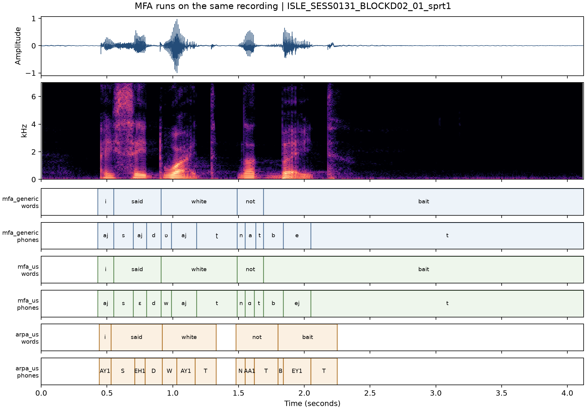

# Part 2a · Montreal Forced Aligner

The six supplied recordings (two speakers, 97.2 seconds, 244 word tokens) are aligned with Montreal Forced Aligner 3.3.10. One script prepares the corpus, validates dictionary coverage, runs the aligner and checks the TextGrids. The corpus is aligned three times, so the effect of the dictionary and of the acoustic model can be read separately.

| Run | Acoustic model | Dictionary | Out-of-vocabulary words | TextGrids |
| --- | --- | --- | --- | --- |
| `mfa_generic` | `english_mfa` v3.1.0 (IPA) | generic `english_mfa` v3.1.0, one pronunciation per word | 5 [hand-written entries](pronunciations.tsv) | [TextGrids/](TextGrids/) |
| `mfa_us` | `english_mfa` v3.1.0 (IPA) | `english_us_mfa`, US English with variants | 6 words from the [`english_us_mfa` G2P model](pronunciations_g2p_english_us_mfa.tsv) | [TextGrids_us_mfa/](TextGrids_us_mfa/) |
| `arpa_us` | `english_us_arpa` v3.0.0 (ARPAbet) | `english_us_arpa`, with variants | 4 words from the [`english_us_arpa` G2P model](pronunciations_g2p_english_us_arpa.tsv) | [TextGrids_us_arpa/](TextGrids_us_arpa/) |

- [PDF report](Alignment_Report.pdf) with the models, sample visualizations and observations
- [Word-boundary agreement between the runs](Results/comparison/summary.md) and the [per-word table](Results/comparison/word_boundaries.csv)
- Interval tables and Praat checks per run: [mfa_generic](Results/), [mfa_us](Results/us_mfa/), [arpa_us](Results/us_arpa/)

`arpa_us` is the run recommended for further use. It has no unknown phones, no phone longer than 0.5 seconds, and no disagreement with the signal in the places examined below.

## Setup

Install [Miniforge](https://github.com/conda-forge/miniforge) and open a terminal with Conda available.

```sh
conda create -n aligner -c conda-forge "python=3.12" "montreal-forced-aligner=3.3" "kaldi=*=cpu*" "pytorch=*=cpu*" ffmpeg
conda activate aligner
python -m pip install -r alignment/requirements.txt
```

The recordings are not redistributed in this repository. Extract the supplied archive so that `Assignment 2a/wav/` and `Assignment 2a/transcripts/` sit in the repository root, or pass their parent folder with `--source`.

The first run uses the plain [English MFA v3.1.0 dictionary](https://github.com/MontrealCorpusTools/mfa-models/releases/download/dictionary-english_mfa-v3.1.0/english_mfa.dict). Save it as `.local/english_mfa.dict`. MFA downloads every other model by name.

## Run everything

```sh
python alignment/pipeline.py
```

This runs the three alignments, the Praat checks, the comparison and the PDF report. Add `--skip-alignment` to rebuild the tables, figures and report from existing TextGrids.

## Run one step

Data preparation groups the files by speaker, converts the audio to 16 kHz mono PCM WAV, and writes a matching UTF-8 `.lab` transcript for each WAV. It expands the written initialisms S.J.C. and WBUR into letters and repairs hyphen-space artifacts such as “seventy- six”.

```sh
python alignment/run.py --prepare-only
```

Each alignment below prepares the corpus, runs `mfa validate` for dictionary coverage, runs `mfa align`, and checks that every WAV has a TextGrid.

```sh
python alignment/run.py --validate --dictionary .local/english_mfa.dict --lexicon-additions alignment/pronunciations.tsv
python alignment/run.py --validate --dictionary english_us_mfa --g2p english_us_mfa --output alignment/TextGrids_us_mfa
python alignment/run.py --validate --acoustic english_us_arpa --g2p english_us_arpa --output alignment/TextGrids_us_arpa
```

`--acoustic` selects a pretrained acoustic model and `--dictionary` a pretrained dictionary name or a local file. `--lexicon-additions` appends hand-written pronunciations. `--g2p` finds the words missing from the dictionary, transcribes them with a pretrained G2P model, saves them as `alignment/pronunciations_g2p_<model>.tsv`, and aligns with the extended dictionary. Both options reject phones outside the dictionary's inventory.

```sh
python alignment/inspect_grids.py --grids alignment/TextGrids_us_arpa --output alignment/Results/us_arpa
python alignment/compare_models.py
python alignment/build_report.py
```

`inspect_grids.py` uses the Praat engine to check the corpus inventory, the tier names, contiguous positive-duration intervals, and durations against the WAVs. It exports an interval table, a per-clip overview, a waveform and spectrogram with both tiers, and `review_flags.csv`, which lists phones longer than 0.5 seconds. The threshold marks candidates for review and does not prove that a boundary is wrong. `compare_models.py` matches word tokens across runs and reports how far their boundaries differ.

## What the alignments show

The words tier and the phones tier are consistent in every run. Each word interval is covered exactly by its phones, and pauses appear as empty intervals in both tiers. MFA places boundaries on a 10 ms frame grid.

| Runs compared | What changes | Speaker | Median shift | Within 20 ms | Within 50 ms | Largest shift |
| --- | --- | --- | ---: | ---: | ---: | ---: |
| `mfa_generic` / `mfa_us` | dictionary | F2BJ | 0 ms | 90% | 95% | 670 ms |
| `mfa_generic` / `mfa_us` | dictionary | ISLE | 0 ms | 93% | 100% | 50 ms |
| `mfa_us` / `arpa_us` | acoustic model | F2BJ | 0 ms | 94% | 98% | 250 ms |
| `mfa_us` / `arpa_us` | acoustic model | ISLE | 15 ms | 63% | 70% | 2440 ms |

A shift is the absolute difference between two runs for the same word start or end. The data have no hand-labelled boundaries, so these numbers measure disagreement and not accuracy. The large shifts come from three specific errors.

**Trailing silence absorbed by the last phone.** With the `english_mfa` acoustic model, the final /t/ of *bait* in ISLE clip 01 runs from 2.050 s to the end of the file at 4.125 s, and the final /d/ of *bed* in clip 03 runs from 1.790 s to 4.500 s. Changing the dictionary does not help, so the cause is the acoustic model. `english_us_arpa` ends the words at 2.250 s and 2.060 s and labels the tail as silence.



**A spoken word labelled as a pause.** In `F2BJRLP1` the transcript reads “… one of the toughest. As W B U R’s Margo Melnicove reports …”. The generic dictionary has the vowel-less entry `ʈ ə f s ʈ` for *toughest*. The aligner ends that word early, places *as* on the rest of it (19.68–19.92 s), and marks 19.92–20.58 s as a pause. The signal level at 20.40–20.55 s is −29 to −31 dBFS, the same as the average of the whole recording, so the spoken *as* was skipped. Both US dictionaries place *as* at 20.35–20.57 s.


**Letter names compressed.** The generic dictionary has *w* as `d ɐ b` and *u* as a single `ɐ`. The missing syllables of “double-u” are pushed into the next letter, and the vowel of *b* is stretched to 390 ms. With full letter names in the US dictionaries, the two acoustic models agree on all four letters within 20 ms.

Dictionary quality mattered more than the acoustic model for the long recordings. The acoustic model mattered for utterance-final silence in the short ISLE clips, which are recordings of a non-native speaker with long quiet tails.

## Inspection in Praat

Open a WAV from `alignment/corpus/` and the TextGrid with the same name in [Praat](https://www.fon.hum.uva.nl/praat/), select both objects, and choose **View & Edit**. Listen around a narrow window before judging an apparent offset. The observations above rest on the spectrogram, the signal level and the agreement between runs. Listening is still needed before any boundary is treated as ground truth.

[MFA installation guide](https://montreal-forced-aligner.readthedocs.io/en/stable/installation.html) · [MFA pretrained models](https://mfa-models.readthedocs.io/)
