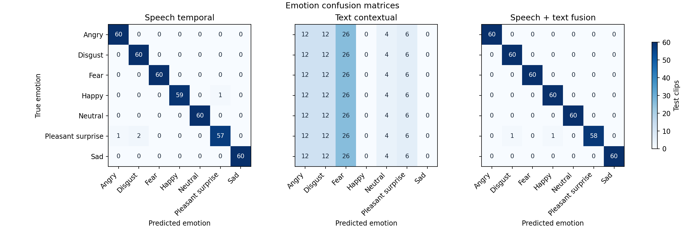
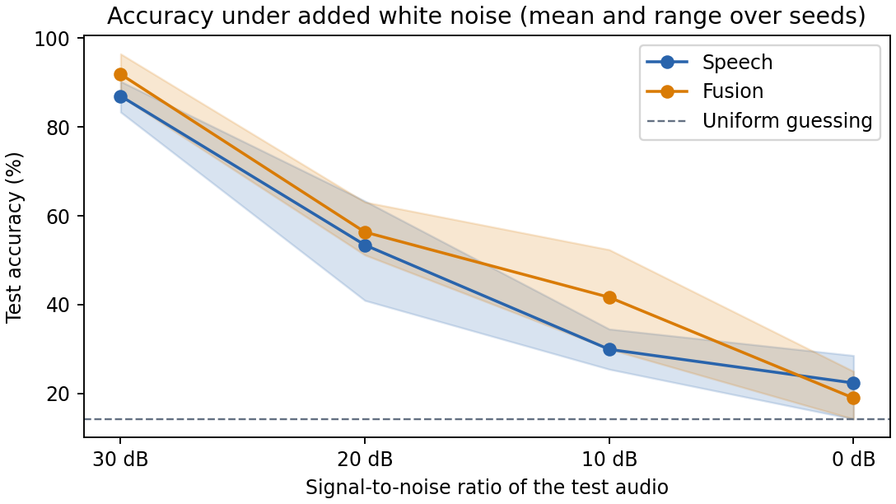
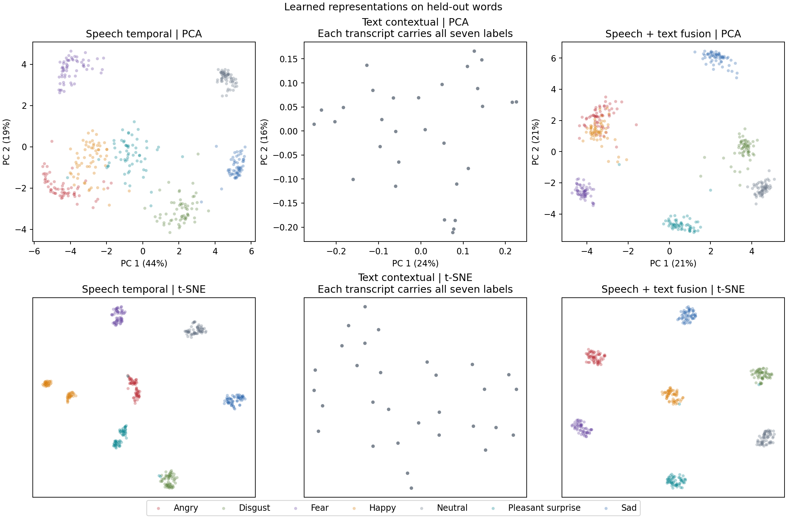

# Part 2b · Multimodal emotion recognition on TESS

Three classifiers predict seven emotions from speech only, from text only, and from speech and text together. They share one preprocessing pipeline, one data split and one training recipe, so their results can be compared clip by clip.

| Model | Correct / total | Accuracy | Macro F1 |
| --- | ---: | ---: | ---: |
| Speech only | 416 / 420 | 99.05% | 0.990 |
| Text only | 60 / 420 | 14.29% | 0.108 |
| Speech + text fusion | 418 / 420 | 99.52% | 0.995 |

Speech carries the emotion in TESS. Text carries none, because every transcript is spoken in all seven emotions. Fusion corrects two of the four speech errors in the released checkpoints, but over five training seeds the two models are equal (99.38% against 99.43%).

## Data and protocol

TESS has two actresses (OAF and YAF) reading 200 target words in seven emotions, always in the carrier phrase “Say the word …”. The Kaggle archive holds two copies of each file. Preparation verifies that the copies are identical, removes them, and maps the one misnamed file `OA_bite_neutral` to speaker OAF. The result is a complete design of 200 words × 2 speakers × 7 emotions = 2,800 clips. The transcript of a clip is rebuilt as “say the word {target word}”, and the text branch sees only that string.

The split is by target word with seed 42: 140 words for training, 30 for validation and 30 for testing, which gives 1,960, 420 and 420 clips. No word crosses splits, and both speakers appear in every split. The test set has 60 clips per emotion, so uniform guessing scores 14.29%. Every transcript in the test set occurs exactly twice with each emotion. A text-only classifier must give all 14 recordings of a transcript the same label, so it scores exactly 1/7 whatever it learns. All three models are tested on the same 420 clips. [Original TESS dataset description](https://doi.org/10.5683/SP2/E8H2MF)

## A. Architecture decisions

| Block | Architecture | Why |
| --- | --- | --- |
| Speech preprocessing | Downmix to mono, remove DC offset, scale to peak 1, resample to 16 kHz with a polyphase filter, trim quiet edges with a 20 ms RMS envelope at 2.5% of the clip maximum | Clips differ in level and in leading and trailing silence. 16 kHz keeps the 0–8 kHz band where voice quality and pitch harmonics lie. Trimming only the edges keeps pauses inside the phrase, which are part of the emotional timing. |
| Speech feature extraction | 64 log-Mel bands from 60 Hz to 7.6 kHz, 25 ms window, 10 ms hop, standardized with training-set mean and deviation. Output is time steps × 64. | Log-Mel energies keep pitch harmonics, spectral tilt and energy contours, the cues that separate emotions. MFCCs would discard part of the pitch structure. The features need no pretrained model, which suits 1,960 training clips. |
| Speech temporal modelling | Linear 64→48 with LayerNorm and GELU, every fourth frame (40 ms), bidirectional GRU with 32 units per direction, masked attention pooling. Output is a 64-dimensional vector. | The emotion is carried by how pitch and energy move across the phrase. A bidirectional GRU reads that trajectory in both directions. Attention pooling lets the model weight the informative frames and ignores padding. Subsampling shortens the sequences fourfold, and a 40 ms step is still shorter than a syllable. |
| Text preprocessing | Lowercase, collapse whitespace, split into characters over a 29-symbol alphabet with one unknown symbol | A word-disjoint split means every test word is unseen. Character tokens represent unseen words without an out-of-vocabulary bucket. |
| Text feature extraction | Learned 24-dimensional character embeddings. Output is tokens × 24. | The vocabulary is tiny and the task has 200 distinct sentences. A pretrained language model would add millions of parameters and still could not separate emotions that share one transcript. |
| Text contextual modelling | Bidirectional GRU with 16 units per direction and masked attention pooling. Output is a 32-dimensional vector. | Each character state depends on its left and right context, so the pooled vector represents the word in its phrase. |
| Fusion | Concatenate the 64-dimensional speech vector and the 32-dimensional text vector, then Linear 96→64 with LayerNorm and GELU. Both encoders are trained jointly with the fusion layer. | Late fusion of pooled vectors suits two streams with different lengths and rates. A learned projection lets training decide how much weight each modality gets. Joint training lets the acoustic encoder adapt to the presence of text. |
| Classifier | Dropout 0.2 and a linear layer to seven logits, trained with cross-entropy | The same head on every model keeps the comparison about the representation and not about the classifier. |

The models have 19,480 (speech), 5,040 (text) and 30,625 (fusion) parameters. Training uses AdamW with learning rate 0.002, batch size 64, gradient clipping at norm 5 and at most 30 epochs. The checkpoint with the best validation macro F1 is kept, and training stops after eight epochs without improvement. The test set is used once, after model selection.

We chose small models trained from scratch over pretrained encoders such as wav2vec 2.0 or BERT. A 19k-parameter speech model already reaches 99% on held-out words, so a larger encoder has almost nothing left to gain on this dataset, and it would make the three-way comparison harder to read.

## B. Experiments

All numbers are on the 420 held-out clips. [Full tables](Results/accuracy.md)

| Emotion | Speech recall | Text recall | Fusion recall | Speech errors fixed by fusion | New fusion errors |
| --- | ---: | ---: | ---: | ---: | ---: |
| Angry | 100.00% | 20.00% | 100.00% | 0 | 0 |
| Disgust | 100.00% | 20.00% | 100.00% | 0 | 0 |
| Fear | 100.00% | 43.33% | 100.00% | 0 | 0 |
| Happy | 98.33% | 0.00% | 100.00% | 1 | 0 |
| Neutral | 100.00% | 6.67% | 100.00% | 0 | 0 |
| Pleasant surprise | 95.00% | 10.00% | 96.67% | 1 | 0 |
| Sad | 100.00% | 0.00% | 100.00% | 0 | 0 |

**Speech only.** Four errors in 420 clips. Three are pleasant-surprise clips labelled disgust (two) or angry (one), and one is a happy clip labelled pleasant surprise.

**Text only.** The model predicts fear for 182 clips, disgust and angry for 84 each, pleasant surprise for 42 and neutral for 28. These are whole transcripts: each of the 30 test transcripts gets one label for all its 14 recordings, and exactly 2 of the 14 are right. The per-class recalls in the table only reflect which labels the model happened to favour. The accuracy is 60 / 420 by construction.

**Speech + text.** Two errors. Fusion fixes one happy and one pleasant-surprise error of the speech model and adds none.

### Is the fusion gain real?

A gain of two clips is small, so every model was trained again with four more seeds. The split and the test clips stay the same, and only weight initialisation and batch order change. [Full robustness tables](Results/robustness.md)

| Seed | Speech | Text | Fusion | Speech errors fixed by fusion | New fusion errors |
| ---: | ---: | ---: | ---: | ---: | ---: |
| 42 (released) | 99.05% | 14.29% | 99.52% | 2 | 0 |
| 1 | 99.52% | 14.29% | 99.05% | 0 | 2 |
| 2 | 99.29% | 14.29% | 99.52% | 2 | 1 |
| 3 | 99.52% | 14.29% | 99.29% | 0 | 1 |
| 4 | 99.76% | 14.29% | 99.52% | 0 | 1 |
| Mean ± SD | 99.43% ± 0.27% | 14.29% ± 0.00% | 99.38% ± 0.21% | 0.8 | 1.0 |

Fusion is ahead in two seeds and behind in three. On average the two models are equal, and the difference in the released checkpoints is training noise. Text scores exactly 14.29% in every seed, as the protocol predicts.

## C. Analysis

### Which emotions are easiest and hardest, and why

Fear, neutral and sad are the easiest. The speech model recognises all 60 test clips of each and assigns no other clip to them (F1 1.000). Neutral and sad also receive the highest mean confidence, 0.990 and 0.984. Angry and disgust have full recall and a few false positives. Pleasant surprise is the hardest (recall 95.0%, F1 0.966), followed by happy (recall 98.3%). These two have the lowest mean confidence with angry: 0.926 for happy, 0.950 for pleasant surprise and 0.953 for angry.

The five seeds confirm the ranking. Out of 300 test predictions per emotion, the speech models make 10 errors on pleasant surprise, 1 on happy, 1 on disgust and none on angry, fear, neutral or sad. The fusion models make 11 on pleasant surprise, 2 on disgust and none elsewhere. Pleasant surprise accounts for 21 of the 25 errors.

The likely reason is how far each emotion sits from the others acoustically. Neutral and sad are low-arousal deliveries, and sad and disgust are also the slowest: after trimming, the mean clip lasts 2.38 s for sad and 2.40 s for disgust against 1.60 s for fear. Fear is short and tense. These emotions differ from the rest in tempo and energy over the whole phrase, which a recurrent model reads easily. Happy, pleasant surprise and angry are all high-arousal deliveries with raised energy, and happy and pleasant surprise are both positive, so they differ mainly in finer pitch movement. The speech representation shows this: on the first two principal components, angry, happy, pleasant surprise and disgust form one continuous band in that order, while fear, neutral and sad stand apart. Every speech error is between neighbours or near-neighbours on that band. We did not measure pitch or energy directly, so this explanation rests on the confusions, the durations and the representation plots.

### When does fusion help most?

On TESS, fusion does not help in a way we can measure, and the reason is the dataset. Fusion can add accuracy only when the second modality knows something the first does not. Here every transcript is spoken in all seven emotions, so the text has no information about the label, and speech is already at 99%.

Three tests support this.

**Seeds.** Over five seeds, speech averages 99.43% and fusion 99.38%. Fusion fixes 0.8 speech errors per run and adds 1.0.

**Text ablation.** The trained fusion models were tested again with the text replaced while the audio stayed the same.

| Text given to the fusion model | Accuracy (mean ± SD) | Predictions that change, of 420 |
| --- | ---: | ---: |
| Matched transcript | 99.38% ± 0.21% | 0 |
| Carrier phrase only, “say the word” | 99.43% ± 0.27% | 0.2 |
| Transcript of another clip | 99.43% ± 0.27% | 0.2 |

Removing or swapping the target word changes one prediction in five runs. The fusion model has learned to ignore the text, which is the correct behaviour for uninformative input.

**Noisy audio.** White noise was added to the test audio. The models never saw noise in training.

| Signal-to-noise ratio | Speech (mean ± SD) | Fusion (mean ± SD) |
| --- | ---: | ---: |
| Clean | 99.43% ± 0.27% | 99.38% ± 0.21% |
| 30 dB | 86.95% ± 2.90% | 91.86% ± 4.26% |
| 20 dB | 53.43% ± 8.68% | 56.33% ± 4.93% |
| 10 dB | 29.95% ± 3.31% | 41.67% ± 8.24% |
| 0 dB | 22.38% ± 6.86% | 19.00% ± 5.51% |

Both models collapse together as the audio degrades, because the text cannot take over when the speech fails. Fusion is somewhat higher at 30 dB and 10 dB and lower at 0 dB, with large variation between seeds. The ablation shows that this cannot come from the transcript. It more likely comes from the extra projection layer and joint training, and five seeds are too few to call it a reliable effect. The steep drop at 30 dB also shows that models trained only on clean studio audio are fragile, and noise augmentation would be the first thing to add for real use.

Fusion should help most when the two modalities are complementary: when the words carry emotion that the voice does not show, as in conversational data, or when one modality is degraded and the other still carries the label. TESS offers neither case. In the released checkpoints the two corrected clips were both low-confidence speech errors (0.61 and 0.58), so the place where fusion changed an outcome was near the decision boundary.

### Error analysis

The released speech model makes four errors and the fusion model two. All involve pleasant surprise or happy.

| Clip | True emotion | Speech prediction (confidence) | Fusion prediction (confidence) | What happens |
| --- | --- | --- | --- | --- |
| `OAF_hash_happy` | Happy | Pleasant surprise (0.61) | Happy (0.99) | The only happy clip that speech misses. It is confused with the other positive high-arousal emotion, at low confidence. Fusion recovers it. |
| `OAF_time_ps` | Pleasant surprise | Disgust (0.58) | Pleasant surprise (0.99) | A low-confidence speech error on the older speaker. Fusion recovers it. |
| `OAF_hall_ps` | Pleasant surprise | Disgust (0.89) | Disgust (0.59) | Both models make the same error. Fusion is far less confident, so the clip sits near the decision boundary, but the label does not change. |
| `YAF_goal_ps` | Pleasant surprise | Angry (0.76) | Happy (0.80) | Both models are wrong in different ways. Each picks another high-arousal emotion, which fits the explanation above. |

Three of the four speech errors are on the older speaker (OAF: 207 / 210 correct, YAF: 209 / 210). Her pleasant-surprise clips are twice taken for disgust, an emotion with a very different meaning but, in her delivery, apparently a similar slow and emphatic contour. Two of the four errors have confidence below 0.61, so a rejection threshold would catch them. The other two are confident mistakes. With four errors in 420 clips these are observations on single clips, not statistics.

### Separability of the learned representations

The plots show the 420 held-out clips in the space each model classifies from: the output of the temporal modelling block (speech), of the contextual modelling block (text) and of the fusion block. The top row is PCA, which keeps global distances. The bottom row is t-SNE, which keeps local neighbourhoods.

| Representation | Dimensions | Silhouette score |
| --- | ---: | ---: |
| Temporal modelling block (speech) | 64 | 0.617 |
| Contextual modelling block (text) | 32 | −0.017 |
| Fusion block | 64 | 0.758 |

**Temporal modelling block.** The seven emotions form seven groups. In PCA, fear, neutral and sad stand apart, and angry, happy, pleasant surprise and disgust are neighbours along a band, which matches the confusions. In t-SNE most emotions split into two sub-clusters. These are the two speakers: splitting each emotion's clips in two with k-means recovers the speaker for at least 97% of the clips in six of the seven emotions (65% for neutral). The representation keeps speaker identity inside each emotion, which is harmless here because both speakers are in the training data.

**Contextual modelling block.** There is nothing to separate. All 14 recordings of a transcript share one point, and that point carries all seven labels, so the plot shows 30 points and the silhouette score is about zero. The block does its job of encoding the word, but the word says nothing about the emotion.

**Fusion block.** The clusters are tighter and further apart than in the speech model, and the silhouette score rises from 0.617 to 0.758. Angry and happy overlap on the first two principal components but are fully separate in t-SNE and in the classifier, which uses all 64 dimensions. The speaker sub-clusters are weaker: the same k-means split recovers the speaker for only 57% to 87% of the clips per emotion. The fusion representation is organised more by emotion and less by speaker than the speech representation.

## Limits of this study

- TESS has two speakers and both are in every split. The results describe new words from known speakers, not new speakers.
- The speech is acted and recorded in a studio with one carrier phrase. Accuracy near 99% is a property of this dataset and does not transfer to spontaneous speech.
- The test set has 420 clips and the models make two to four errors. Differences of one or two clips are within the variation between training seeds.
- The text result is a consequence of the dataset design. It does not show that text is uninformative for emotion in general.
